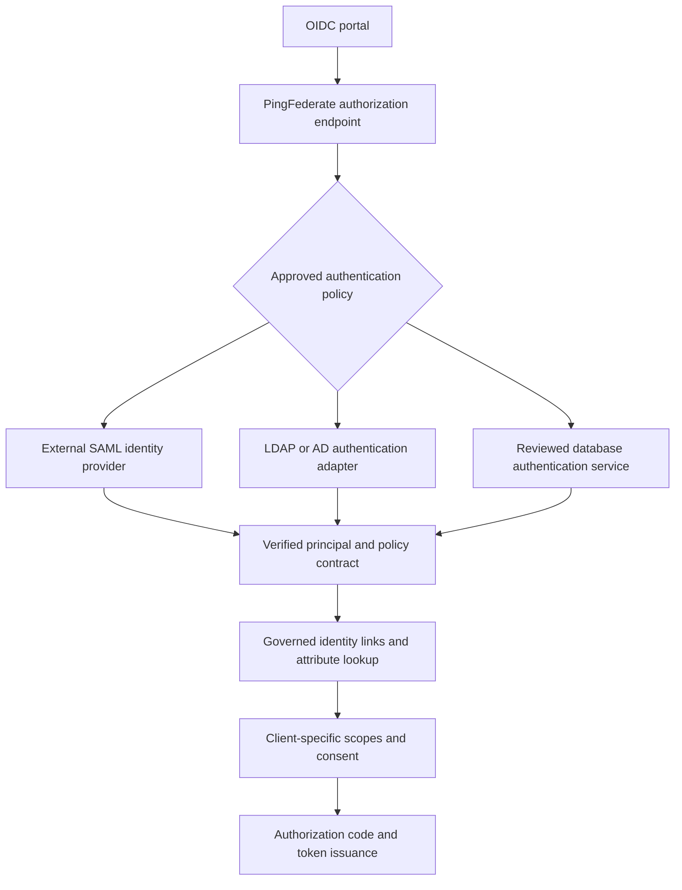

# SAML, OAuth and OIDC with LDAP, database and AD users

## Scenario

A customer portal speaks OIDC. A legacy partner authenticates with SAML. Customer profiles are in LDAP, employee identities are in Active Directory and business permissions are in a relational database. Some people have records in all three stores.

This is a configuration walkthrough plus an executable entitlement-policy model, not an importable PingFederate configuration or a running identity provider. Baseline: PF 13.1 documentation, checked 26 October 2026. Some linked datastore references describe 12.3; confirm settings against the installed version.

## Roles in the browser flow



PingFederate acts as a SAML SP toward the external IdP and as an OAuth authorization server/OIDC provider toward the portal. It validates the SAML authentication result, applies policy, then issues an authorization code. It does not turn XML into a JWT by string conversion. The portal exchanges the code with PKCE and its registered client authentication; the API accepts an appropriate access token, not the ID token.

## Configure the building blocks

1. Establish trust in the SAML IdP connection: metadata, entity IDs, signing certificates, ACS and permitted bindings. Validate signature, destination/recipient, audience, timing, response correlation and replay. Test certificate rotation and rejected assertions.
2. Create an authentication policy contract with a stable subject and the minimum required context. Route only to approved authentication sources; deny an unresolved route. Map each successful source into that contract.
3. Map the policy contract to OAuth persistent grants and configure access-token mappings. Configure the OIDC policy and an authorization-code client with exact redirect URIs, S256 PKCE and bounded scopes. Set user consent where required.

Sources: [authentication policies](https://docs.pingidentity.com/pingfederate/13.1/administrators_reference_guide/pf_authentication_policies.html), [OAuth use cases](https://docs.pingidentity.com/pingfederate/13.1/administrators_reference_guide/pf_config_oauth_use_cases.html).

## Three datastores do not mean three passwords per login

| Store | Authentication approach | Attribute/authorization role |
| --- | --- | --- |
| LDAP customer directory | HTML Form Adapter with configured LDAP credential validation, or trusted upstream IdP | Customer subject and profile/groups |
| Active Directory | Appropriate LDAP credential validation over TLS or a configured Kerberos/upstream enterprise IdP flow | Immutable directory identity and selected group memberships |
| Relational database | Federate to its authentication service, or use a reviewed custom adapter/PCV that verifies the existing password-hash scheme | JDBC queries for business entitlements keyed by canonical person ID |

Configure Directory (LDAP) datastores under System > Data & Credential Stores > Data Stores. Use LDAPS/StartTLS, narrowly scoped service credentials and tested failover. A JDBC datastore connection provides data access; it is not automatically a database-password validator. Do not implement clear-text password comparison in SQL. Keep the relational service's existing authentication protections.

Sources: [LDAP configuration](https://docs.pingidentity.com/pingfederate/12.3/administrators_reference_guide/help_datasourcetasklet_ldapconfigstate.html), [PCV model](https://docs.pingidentity.com/pingfederate/12.3/administrators_reference_guide/help_passwordcredentialvalidatortasklet_passwordcredentialvalidatormgmtstate.html), [JDBC configuration](https://docs.pingidentity.com/pingfederate/12.3/administrators_reference_guide/pf_configuring_jdbc_connection.html).

Do not try a submitted password against all stores until one succeeds. Define the population/realm and authentication authority explicitly; ambiguous identity or source outage must not downgrade authentication.

## Correlate overlapping accounts safely

Use a governed link table, for example:

| Canonical person | Source | Immutable source identifier |
| --- | --- | --- |
| person-001 | AD | ad-object-001 |
| person-001 | LDAP | ldap-entry-001 |
| person-001 | Database | db-row-001 |

The values are synthetic strings standing in for real immutable identifiers. An AD objectGUID may require binary conversion; do not assume a username or email is immutable. A trusted SAML issuer+subject also needs an explicit governed link before enrichment. The runnable model currently accepts normalized LDAP/AD/database principals; a SAML principal requires an additional verified upstream normalization adapter, which is not implemented here.

Never auto-merge on matching email, display name or sAMAccountName. A customer and employee with the same email may be different identities. Account linking requires proof, audit and a recovery/unlink process. Give PF a globally unique USER_KEY so persistent grants cannot collide across populations.

Sources: [OAuth mapping and USER_KEY](https://docs.pingidentity.com/pingfederate/13.1/introduction_to_pingfederate/pf_mapp_oauth_attri.html), [policy contract sources](https://docs.pingidentity.com/pingfederate/13.1/administrators_reference_guide/pf_policy_contracts.html).

## Group-level access model

This lab deliberately avoids blindly unioning all groups:

| Resource scope | Required evidence |
| --- | --- |
| accounts:read | LDAP customer-readers OR DB accounts-reader |
| payments:approve | AD payments-approvers AND DB approve-payments AND verified MFA |
| Anything else | Denied unless a new explicit policy is reviewed |

Only fresh, active records for explicitly linked accounts count. Required lookup failures deny issuance. Requested scopes are intersected with the client's configured allowlist and the computed entitlement set. Consent is an additional condition, not supplied by this model. The privileged example is an internal approval scenario; do not treat it as a CDR scope definition.

```sh
npm test
node --input-type=module -e "import {readFileSync} from 'node:fs'; import {resolveEntitlements} from './src/multi-store-entitlements.mjs'; console.log(resolveEntitlements(JSON.parse(readFileSync('fixtures/multi-store-person.json','utf8'))));"
```

The JSON fixture is trusted test input, not an HTTP request contract. The function does not query stores, verify SAML, perform MFA or issue a token. In a deployment, populate it exclusively from verified server-side sources through a reviewed integration.

## Example attribute queries

A backend JDBC query should bind a canonical ID rather than concatenate it:

```sql
SELECT entitlement_code
FROM person_entitlements
WHERE person_id = ? AND status = 'ACTIVE';
```

The question mark is a prepared-statement bind parameter, not literal PF UI syntax. Configure the version-specific PF parameter mapping. Use escaped LDAP filter assertion values; parameter syntax differs between the application SDK and PF's datastore UI.

Store group authorities separately: an AD group named admin is not the same as a database entitlement named admin. Expand nested AD groups only if the chosen retrieval method explicitly supports it; document token group limits and avoid embedding a huge directory group list in every token.

## Freshness, refresh and logout

PF's grant mapping and access-token mapping have different lifecycles. Decide which entitlements are persisted at login and which are re-evaluated during access-token issuance/refresh. A copied grant attribute is not a live group lookup. Define how quickly a removed group or disabled account must stop access; use bounded token lifetime, revocation/introspection or a fresh resource policy as appropriate. Document failure behaviour when the authoritative entitlement store is down.

SAML single logout, the PF browser session, OIDC logout, refresh-token revocation and API-token expiry are distinct mechanisms. Test them individually and together.

## Optional assertion grant

A SAML bearer assertion grant at the token endpoint is a different flow from browser SAML-to-OIDC federation. Use it only with an explicit trusted issuer, token-endpoint audience, client policy and replay checks. Do not send any arbitrary captured browser assertion to the token endpoint and expect it to work.

## Integration acceptance matrix

- LDAP-only, AD-only, database-authenticated and explicitly linked multi-store people.
- Two people with identical emails/usernames remain separate.
- Invalid SAML signature, wrong audience, expired assertion and replay are rejected.
- Disabled linked account, stale lookup and required-store outage deny.
- A low-privilege client cannot request payments:approve.
- Group removal is reflected within the stated freshness target, including refresh.
- No credentials, assertion bodies or tokens appear in logs.

Record the actual product/library versions and results. Local policy unit tests do not establish federation compatibility or protocol compliance.
